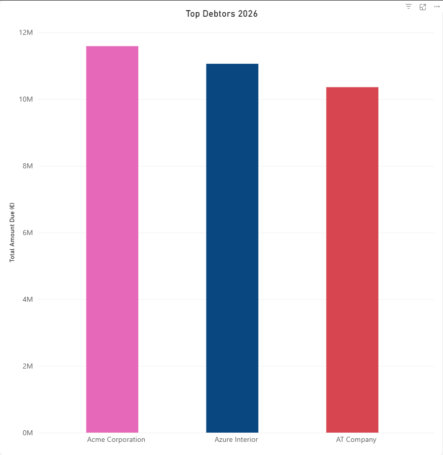
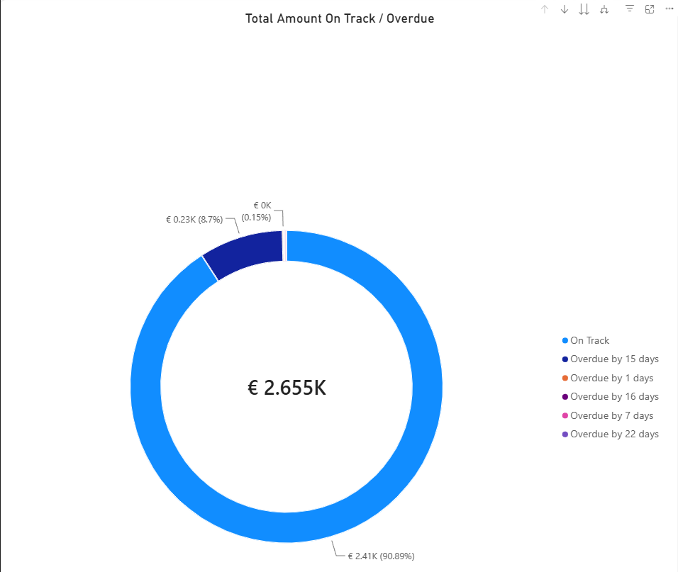
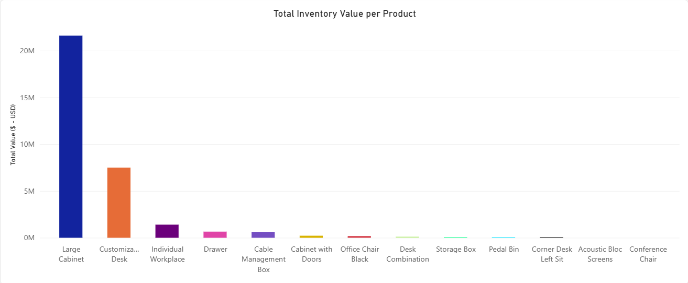
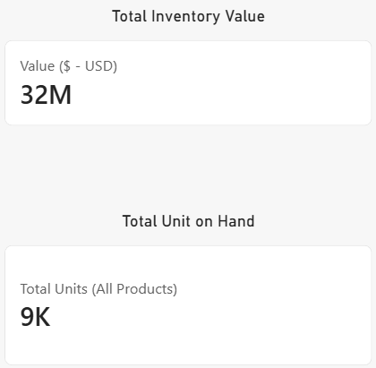

Odoo Project & Power BI Analytics

## Project Summary  
A Python and Power BI data engineering and business intelligence project automating the extraction, transformation, and reporting of financial data (account.move) from a self-hosted Odoo ERP system. The pipeline extracts invoice records, calculates aging metrics, and visualizes cash flow risks and customer payment behavior across thousands of synthetic invoice transactions.

## Overview

This project bridges transactional ERP operations and executive business intelligence. Using Python (xmlrpc.client, pandas), the pipeline authenticates against Odoo's native XML-RPC web service API, extracts raw customer invoice records, dynamically calculates overdue days based on maturity dates, and structures the output into tabular formats for Power BI analytics. Key analytical capabilities include:

* **Overdue & Risk Tracking:** Quantifying aging parameters per invoice and categorizing records into actionable status buckets (On Track, Overdue by X days).
* **Customer Exposure Analysis:**  Identifying high-risk debtor accounts by aggregating total outstanding balances across major debtors (e.g., Acme Corporation, Azure Interior, AT Company).
* **Temporal Cash Flow Forecasting:** Visualizing monthly invoice due balances to highlight seasonal cash inflow patterns and potential liquidity bottlenecks.

## Data Architecture (Direct Integration Pipeline)

To optimize engineering effort and deliver immediate business value, the solution employs a lean, highly efficient integration architecture connecting directly to Odoo's operational data store:
* **Data Extraction:** Authenticates dynamically using Odoo's common and object XML-RPC endpoints to query the account.move model (filtering by move_type='out_invoice').
* **Transformation:** Utilizes Pandas to clean schema fields, standardize timestamp formats, map payment status markers, and calculate vector-based Days Overdue logic relative to execution dates.
* **Storage & Consumption:** Exports processed records directly to overdue_invoices_report.csv and feeds data directly into Power BI Desktop for interactive visual analytics.

## Tools & Technologies

* **Platform:** VS Code & Power BI
* **Languages:** Python (Pandas), DAX

## Key Odoo Analytics & Insights

Visual 1 ('Top Debtors 2026'): 

* **High Receivables Concentration:** All three top debtors exceed **€10M** in total amount due, led by **Acme Corporation** (~€11.5M), followed closely by **Azure Interior** (~€11.0M) and **AT Company** (~€10.4M).
* **Balanced Top-Tier Exposure:** The gap across the top three accounts is relatively narrow (~€1.1M spread between #1 and #3), meaning collection performance on any single major account materially impacts total receivables.

Visual 2 ('Total Amount On Track / Overdue'): 

* **Majority Current (`On Track`):** Out of **€2.655K** tracked, **€2.41K (90.89%)** is currently `On Track`, keeping overall due payments very low.
* **Overdue Breakdown:**
  * **Primary Overdue Bucket:** `Overdue by 15 days` accounts for the largest overdue share at **€0.23K (8.7%)**.
  * **Minor / Tail Buckets:** Other overdue aging brackets (`1`, `7`, `16`, and `22` days) make up a minimal share (**0.15%** / rounded to **€0K** at `K` scale).

Visual 3 (Total Inventory Value per Product):

* **Macro Inventory Baseline:** Across all products, total catalog valuation reaches **32M** ($ - USD) across **9K** total units on hand.
* **Top-Heavy Value Concentration:** Inventory value is strongly concentrated in **Large Cabinet** (exceeding **20M** USD), followed by **Customizable Desk** (**7.5M** USD) and **Individual Workplace** (**1.4M** USD).
* **Long-Tail & Minimal-Value Items:** Mid-tier items such as **Drawer**, **Cable Management Box**, **Cabinet with Doors**, **Office Chair Black**, **Desk Combination**, **Storage Box**, **Pedal Bin**, and **Corner Desk Left Sit** contribute smaller shares near the lower end of the axis, while **Acoustic Bloc Screens** and **Conference Chair** sit near **0M** USD in total value.

**NOTE**:
.
.

